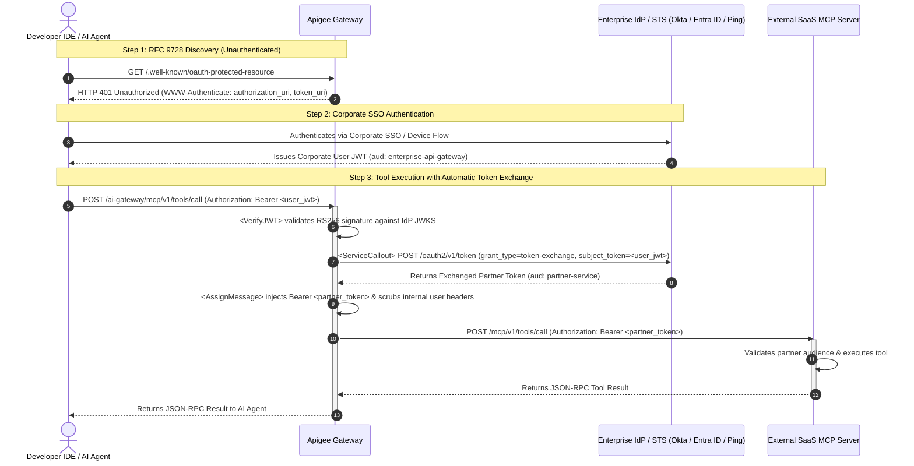
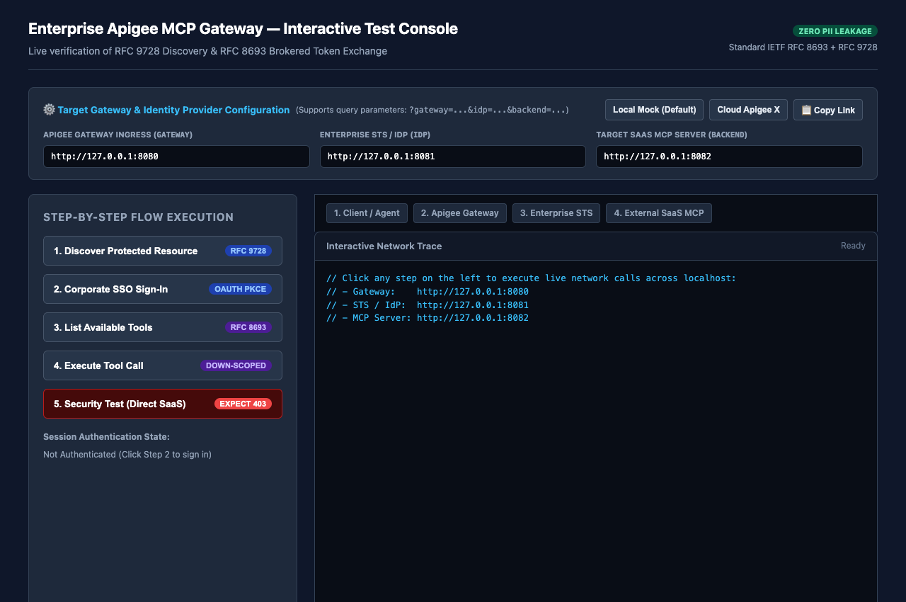

# Enterprise Apigee MCP Gateway: Token Exchange & Discovery

[](LICENSE)

A production-grade, vendor-neutral reference architecture and runnable test harness demonstrating how an enterprise **Apigee API Gateway** mediates access between internal developer AI coding assistants (VS Code, Cursor, Windsurf, Claude Code) and external third-party SaaS Model Context Protocol (MCP) servers.

This architecture leverages two open standards:
- **[IETF RFC 8693](https://datatracker.ietf.org/doc/html/rfc8693):** OAuth 2.0 Token Exchange
- **[IETF RFC 9728](https://datatracker.ietf.org/doc/html/rfc9728):** OAuth 2.0 Protected Resource Metadata Discovery

| Role / Goal | Where to Start |
| :--- | :--- |
| **Evaluate Locally (60 Seconds)** | Jump to **[Quickstart](#quickstart-testing-live-verification--client-setup-portal)** (`make test` / `pytest` for unit tests or `make console` for the [Interactive Protocol Console](#interactive-protocol-console-live-network-demo)). |
| **Integrate Apigee with a Backend MCP URL** | Read **[Backend MCP Server Integration Guide](docs/BACKEND.md)** for the token contract, HTTP status matrix (`200`/`401`/`403`/`404`), and `./verify` live verification CLI. |
| **Deploy the Backend to Cloud Run (Optional)** | Read **[Publishing the Backend MCP Server to Cloud Run](docs/CLOUD-RUN.md)** for one-command `gcloud run deploy` setup. |
| **Connect an IDE / CLI Coding Agent** | Jump to **[CLI Agent & IDE Integration](#cli-agent--ide-integration)** to connect Antigravity CLI, Claude Code, Cursor, or VS Code. |

---

## The Enterprise Challenge

Connecting developer IDE AI agents to external third-party SaaS MCP servers introduces two major enterprise security dilemmas:

```
❌ The Dangerous Anti-Patterns:
1. Long-Lived Static API Keys on Laptops:
   Developer IDE ──[Static SaaS API Key]──> External SaaS MCP Server (Risk: Secret leakage, no RBAC, no revocation)

2. Leaking Corporate Identity Direct to 3P SaaS:
   Developer IDE ──[Corporate Okta/Entra ID JWT]──> External SaaS MCP Server (Risk: Leaks employee emails, roles & internal claims)
```

### The Architectural Solution: Brokered Token Exchange
The enterprise gateway solves this by acting as an **OAuth 2.0 Token Exchange Broker**:
1. The developer's IDE authenticates exclusively with the internal corporate Identity Provider (IdP) via SSO.
2. The IDE sends requests to the **Apigee Gateway** using the short-lived corporate user JWT.
3. Apigee intercepts the request, calls the enterprise IdP's Security Token Service (STS) to perform an **RFC 8693 Token Exchange**, and trades the corporate identity for a down-scoped partner token.
4. Apigee strips all internal employee claims (`sub`, `email`, employee IDs) and injects the partner token before forwarding the call to the SaaS vendor.

---

## Architectural Sequence Flow



---

## Token Transformation Visual: The Privacy & Security Boundary

The core value proposition of this pattern is ensuring **zero PII leakage** and **strictly scoped partner access**:

| Token Property | Ingress Corporate User JWT (IDE $\rightarrow$ Apigee) | Egress Exchanged Token (Apigee $\rightarrow$ SaaS MCP) |
| :--- | :--- | :--- |
| **Audience (`aud`)** | `https://api-gateway.example.com` (Internal Gateway) | `https://mcp.partner-service.example.com` (Target SaaS) |
| **Subject (`sub`)** | Internal Employee ID / Username | Down-scoped Pseudonymous Subject or Service ID |
| **Employee Claims** | `email`, `department`, `groups`, `roles` | **Completely Omitted / Stripped** |
| **Actor Claim (`act`)** | N/A | `{"sub": "apigee-gateway-client"}` |
| **Scope (`scope`)** | `openid`, `profile`, `internal-tools` | `tools:read`, `tools:execute` (Targeted Scopes) |
| **Lifetime (`exp`)** | Standard corporate session (e.g. 1 hour) | Down-scoped, short-lived (e.g. 15 minutes) |

```json
// Ingress Corporate JWT (Held on Laptop)
{
  "iss": "https://identity.example.com/oauth2/v1",
  "sub": "emp_94821",
  "email": "developer@example.com",
  "roles": ["engineering", "internal-developer"],
  "aud": "https://api-gateway.example.com"
}

// ──[ Apigee RFC 8693 Token Exchange ]──>

// Egress Exchanged Partner Token (Delivered to SaaS Vendor)
{
  "iss": "https://identity.example.com/oauth2/v1",
  "sub": "anon-dev-agent-3948",
  "aud": "https://mcp.partner-service.example.com",
  "scope": "tools:read tools:execute",
  "act": {
    "sub": "apigee-mcp-gateway"
  }
}
```

---

## Developer IDE / Client Configuration

AI coding tools (VS Code Claude Extension, Cursor, Windsurf, Claude Code) connect directly to the **Apigee Gateway Ingress Endpoint**. The developer never handles SaaS API keys or vendor credentials:

```json
{
  "mcpServers": {
    "enterprise-partner-mcp": {
      "type": "sse",
      "url": "https://api-gateway.example.com/ai-gateway/mcp/v1/sse"
    }
  }
}
```

When the client connects:
1. The IDE receives an **RFC 9728 Discovery Challenge** (`HTTP 401 Unauthorized`) with `WWW-Authenticate: authorization_uri="...", token_uri="..."`.
2. The IDE triggers an internal corporate browser/device SSO flow and stores the short-lived corporate JWT.
3. Every subsequent tool call passes through Apigee, where tokens are exchanged seamlessly in-flight.

---

## How to Configure for Your Enterprise IdP (e.g., Okta, Entra ID, Ping)

This reference architecture is designed to map directly to any OAuth 2.0 authorization server that supports RFC 8693 token exchange.

### 1. Identity Provider (IdP) Setup (Okta / Entra ID)
In your corporate IdP console:
1. **Register Apigee Gateway as an OAuth Client:**
   - Client Type: Confidential Client (`client_id` + `client_secret` or mTLS private key JWT).
   - Allowed Grant Types: Enable `Token Exchange` (`urn:ietf:params:oauth:grant-type:token-exchange`).
2. **Configure an Access Policy Rule for Token Exchange:**
   - **Incoming Subject Token:** Must be issued by your corporate IdP with audience set to your Apigee gateway (`aud: enterprise-api-gateway`).
   - **Allowed Actions:** Allow Apigee's `client_id` to exchange the subject token for the target partner audience (e.g. `aud: https://mcp.partner-service.example.com`).
   - **Down-scoped Scopes:** Limit token scopes to `tools:read` and `tools:execute`.
   - **Actor Claims:** Ensure the IdP issues the exchanged token with an actor claim designating Apigee (`act: { sub: "apigee-gateway-client-id" }`).

### 2. Apigee Policy Configuration
The included [`apiproxy/`](apiproxy/) bundle uses standard Apigee policies. To map it to your environment:

1. **Verify Corporate User JWT (`policies/VA-VerifyUserJWT.xml`):**
   - Update `<JWKS uri="https://auth.example.com/oauth2/v1/keys"/>` to your IdP's JWKS endpoint (e.g., `https://your-org.okta.com/oauth2/default/v1/keys`).
   - Set `<Issuer>` to your IdP's issuer URL.
2. **Execute Token Exchange Callout (`policies/SC-RFC8693-TokenExchange.xml`):**
   - Store your Apigee client credentials in an **Apigee Key-Value Map (KVM)** (`private.apigee_client_id`, `private.apigee_client_secret`).
   - Update `<URL>` to your IdP's token endpoint (`https://your-org.okta.com/oauth2/default/v1/token`).
   - Set `<FormParam name="audience">` to the target SaaS partner's audience identifier.
3. **Outbound Partner Target (`targets/default.xml`):**
   - Point `<URL>` to the partner's HTTPS MCP endpoint (e.g. `https://mcp.partner-service.com`). See the **[Backend MCP Server Integration Guide](docs/BACKEND.md#3-configuring-the-apigee-proxy-target)** for the complete target configuration and token contract.

---

## Backend Integration & Cloud Deployment Guides

### 1. Integrating with the Backend MCP Server
Once the reference Backend MCP Server is reachable at an HTTPS URL, Apigee (or any RFC 8693 Token Exchange broker) connects to its `/mcp/v1/tools/list` and `/mcp/v1/tools/call` endpoints using down-scoped partner tokens (`aud: <BACKEND_MCP_URL>`, `token_use: exchanged_partner_token`). See the **[Backend MCP Server Integration Guide](docs/BACKEND.md)** for the complete token verification contract, HTTP status code matrix (`200`, `401`, `403`, `404`), Apigee `TargetEndpoint` wiring, and `./verify` live verification CLI commands.

### 2. Optional: Publishing the Backend to Cloud Run
While the backend integration contract is completely cloud-agnostic, you can host the backend MCP server as a public serverless container on Cloud Run in a single command. See **[Publishing the Backend MCP Server to Cloud Run](docs/CLOUD-RUN.md)** for step-by-step instructions using standard `gcloud run deploy` commands, including how to handle enterprise `iam.allowedPolicyMemberDomains` organization policies.

---

## Repository Structure

```text
.
├── verify                  # Executable CLI for unit & sticky live backend verification
├── CONTRIBUTING.md         # Architecture boundaries, test tiers & maintainer notes
├── Makefile                # setup, test, console, bundle, clean
├── pyproject.toml          # Test harness dependencies (FastAPI, FastMCP, Pytest)
├── gapp.yaml               # Optional declarative Cloud Run deployment manifest
├── architecture_flow.mmd   # Source Mermaid sequence diagram
├── console.html            # Interactive visual protocol console for live network tracing
├── run_console.py          # One-command local console & mock service runner
├── client_bridge.py        # Stdio-to-HTTP MCP bridge for CLI agents & IDEs
│
├── docs/
│   ├── BACKEND.md          # Cloud-agnostic backend MCP contract, status codes & verification
│   ├── CLOUD-RUN.md        # Optional guide to publish the backend MCP server to Cloud Run
│   └── console-preview.png # Visual protocol console screenshot
│
├── apiproxy/               # Production Apigee API Proxy Bundle
│   ├── apiproxy.xml
│   ├── proxies/default.xml # Ingress routing & RFC 9728 discovery challenge
│   ├── policies/           # VerifyJWT, ServiceCallout (RFC 8693), ExtractVariables, AssignMessage
│   └── targets/default.xml # Outbound partner SaaS target endpoint
│
├── mock_idp/               # Runnable Enterprise IdP / STS Mock (RFC 8693, JWKS & SSO Login)
│   └── app.py
├── mcp_server/             # Runnable External SaaS MCP Server Mock
│   └── server.py
├── mock_gateway/           # Runnable Gateway Runner (simulates Apigee policies locally)
│   └── app.py
│
└── tests/
    ├── unit/               # Fast, offline in-process sociable unit tests (default pytest)
    │   └── test_protocol_flow.py
    └── integration/        # Opt-in live integration tests against a deployed backend URL
        └── real-user/
            └── test_live_backend.py
```

---

## Interactive Protocol Console (Live Network Demo)



To experience the architecture visually and inspect real HTTP/OAuth traffic in real time:

```bash
make console
```

This launches all three local services on loopback ports (`8080`, `8081`, `8082`) and automatically opens `console.html` in your default browser.

### Workstation & Browser Compatibility
* **Cross-Platform:** Works on macOS, Linux, and Windows with Python 3.11+.
* **Any Modern Browser:** Chrome, Edge, Firefox, or Safari (uses standard ES6 `fetch()`, `window.open()`, and `window.postMessage()`; zero browser extensions required).
* **Live Network Traffic:** Every click makes real HTTP calls across localhost TCP sockets. Open your browser's Developer Tools (`Network` tab) to inspect the headers, status codes, and JSON-RPC payloads live.

### Testing Flexible Environments & Custom Gateways (Query Parameters)
The test console supports dynamic URL query parameters so you can toggle between your local simulation and real cloud environments with zero code modifications:

| Query Parameter | Description | Default Value |
| :--- | :--- | :--- |
| **`?gateway=`** | Ingress Apigee Gateway URL | `http://127.0.0.1:8080` |
| **`?idp=`** | Corporate Identity Provider / STS Base URL | `http://127.0.0.1:8081` |
| **`?backend=`** | Target External SaaS MCP Server Base URL | `http://127.0.0.1:8082` |

**Example Scenarios:**
* **Testing Live Cloud Apigee X:**  
  Load the console with your Apigee cloud ingress endpoint:  
  `console.html?gateway=https://api.yourcompany.com/ai-gateway`
* **Testing Real Okta / Entra ID:**  
  Point the console to your corporate IdP:  
  `console.html?idp=https://dev-xxxx.okta.com`
* **One-Click Presets & Shareable Links:**  
  Use the **Presets** buttons in the console header (`Local Mock`, `Cloud Apigee X`) or click **📋 Copy Link** to share the exact test configuration with colleagues.

### Step-by-Step Interactive Journey

1. **Step 1: Discover Protected Resource (`RFC 9728`)**
   - The browser client sends an unauthenticated `GET /.well-known/oauth-protected-resource` to the Apigee Gateway (`:8080`).
   - Apigee responds with **`HTTP 401 Unauthorized`** and attaches the `WWW-Authenticate` header with the authorization and token endpoints.
2. **Step 2: Corporate SSO Sign-In (`OAuth 2.0 PKCE`)**
   - Click "Sign In with SSO". A real browser popup window opens to the **Corporate Identity Provider Sign-In Page** (`:8081/oauth2/v1/authorize`).
   - Pre-filled with demo credentials (`developer@example.com` / `demo123`).
   - Clicking "Authenticate" issues an authorization code, exchanges it for a **Corporate User JWT**, and displays the internal employee claims (`sub`, `aud: enterprise-api-gateway`, `roles`).
3. **Step 3: List Available Tools (`RFC 8693 Token Exchange`)**
   - The client calls `POST /mcp/v1/tools/list` on Apigee with the Corporate User JWT.
   - Watch all four architecture nodes illuminate: Apigee intercepts the user token, calls the Enterprise STS (`:8081`) to perform the RFC 8693 token exchange, scrubs internal employee claims, and returns the available tools (`search_catalog`).
4. **Step 4: Execute Tool Call (`search_catalog`)**
   - The client invokes `search_catalog` through Apigee.
   - Apigee injects the down-scoped partner token (`aud: https://mcp.partner-service.example.com`), and the SaaS backend executes the tool and returns the JSON-RPC response.
5. **Step 5: Security Boundary Enforcement (Negative Test)**
   - Attempts to send the Corporate User JWT directly to the external partner backend (`:8082`), bypassing Apigee.
   - The SaaS backend **rejects it with `HTTP 403 Forbidden`** (*"Direct corporate user tokens rejected"*), proving that external partners cannot accept corporate identity tokens.

---

## CLI Agent & IDE Integration

You can connect real coding agents (Antigravity CLI, Claude Code, Cursor, VS Code) directly to the gateway via the included stdio bridge:

### 1. Antigravity CLI (`agy`)

Register the Apigee MCP Gateway with the CLI:
```bash
agy mcp add enterprise-catalog mcp-gateway-client
# Or directly referencing the local environment binary:
agy mcp add enterprise-catalog .venv/bin/mcp-gateway-client
```

Ask the agent to execute a tool:
```bash
agy "Search the enterprise catalog for organic apples using the enterprise-catalog tool"
```

**Verified Agent Terminal Output:**
```text
I called `search_catalog` on the `enterprise-catalog` MCP server for `'organic apples'`.

Result:
> Found 3 catalog results matching query: 'organic apples'.
```

Behind the scenes:
1. The CLI agent launches `mcp-gateway-client` over stdio.
2. The client checks for a cached corporate SSO JWT (launches in-browser sign-in if unauthenticated).
3. The agent sends `tools/call` for `search_catalog`.
4. The client forwards the request to **Apigee Gateway (`:8080`)** with `Authorization: Bearer <user_jwt>`.
5. Apigee verifies the user JWT, executes the RFC 8693 Token Exchange with **Enterprise STS (`:8081`)**, and injects the down-scoped partner token.
6. The **SaaS Backend (`:8082`)** validates the partner token, executes the tool, and returns the catalog result back to the agent!

### 2. Claude Code CLI

```bash
claude mcp add enterprise-catalog mcp-gateway-client
# Or:
claude mcp add enterprise-catalog .venv/bin/mcp-gateway-client
```

Execute an agentic prompt:
```bash
claude -p "Use the enterprise-catalog tool to search for organic produce"
```

### 3. Cursor / VS Code (`mcp.json` / `settings.json`)

```json
{
  "mcpServers": {
    "enterprise-catalog": {
      "command": "mcp-gateway-client",
      "args": []
    }
  }
}
```

---

## Quickstart: Testing, Live Verification & Client Setup Portal

### Prerequisites
- Python 3.11+
- `make` *(optional — manual virtualenv commands are also shown below)*

### 1. Setup Local Virtualenv (`make setup` or Manual `venv`)

Using `make` (idempotently creates `.venv` and installs dependencies):
```bash
make setup
```

Or transparently using standard Python `venv` + `pip`:
```bash
python3 -m venv .venv
source .venv/bin/activate
pip install --upgrade pip
pip install -e ".[dev]"
```

### 2. Fast In-Process Unit Tests (`make test` or `pytest`)

You can run the unit test suite via `make test` (which automatically ensures `.venv` is set up first) or by running `pytest` directly inside the activated virtualenv:
```bash
# Option 1: Via Makefile (auto-runs setup if needed)
make test

# Option 2: Directly via pytest (runs tests/unit/ by default)
pytest
```
Runs completely in-process via `httpx.ASGITransport` with zero local port bindings or network dependencies, verifying all 12 positive (`200`) and negative (`401`, `403`, `404`, `413`, `429`) protocol scenarios:
- Health probe (`GET /` and `GET /health` $\rightarrow$ `200`).
- RFC 9728 discovery challenge (`GET /.well-known/oauth-protected-resource` $\rightarrow$ `401` + `WWW-Authenticate` header).
- Missing `Authorization` header rejection (`401`).
- Tampered JWT signature rejection (`401`).
- Wrong `aud` claim rejection (`401`).
- Direct corporate user token rejection (`token_use="user_identity"` $\rightarrow$ `403`).
- Valid RFC 8693 exchanged partner token acceptance on `tools/list` (`200`) and `tools/call` (`search_catalog` $\rightarrow$ `200`).
- Dynamic RFC 8707 audience matching (`aud` matching the service's own base URL $\rightarrow$ `200`).
- Hosted `/client-setup` page modes (`CLIENT_SETUP_PAGE=OFF` $\rightarrow$ `404`, `SAFE` $\rightarrow$ `200` redacted, `UNSAFE` $\rightarrow$ `200` visible).
- POC abuse and FinOps guards (`>16 KB` payload $\rightarrow$ `413`, rate limit exceeded $\rightarrow$ `429`).
- Unknown tool call rejection (`404`).

### 3. Live Backend Verification CLI (`./verify`)

Once the Backend MCP Server is deployed (see **[Backend MCP Server Integration Guide](docs/BACKEND.md)** and **[Publishing the Backend MCP Server to Cloud Run](docs/CLOUD-RUN.md)**), use `./verify` to execute a human-friendly, 9-step live HTTP verification report over HTTPS.

- `./verify` requires **zero external libraries** (pure Python 3 stdlib) and caches your target URL and optional `--signing-key` in `~/.cache/apigee-mcp-token-exchange/context.json`.
- It prints your **Target Backend URL**, the clickable **`/client-setup` Portal URL**, the **`/health` URL**, and the exact HTTP method, URL, auth token, status code, and JSON response for each check:

```bash
# First run (saves URL to ~/.cache/apigee-mcp-token-exchange/context.json and runs all 9 live checks):
./verify https://your-mcp-backend.example.com

# Optional: if deployed with a custom MCP_JWT_SECRET, pass --signing-key once (also cached):
./verify https://your-mcp-backend.example.com --signing-key <YOUR_MCP_JWT_SECRET>

# Subsequent runs (automatically reuses your cached URL and signing key):
./verify
```

**Sample `./verify` Terminal Output:**
```text
====================================================================================
APIGEE MCP BACKEND - LIVE ENDPOINT VERIFICATION
====================================================================================
Target Backend URL     : https://your-mcp-backend.example.com (cached in ~/.cache/apigee-mcp-token-exchange/context.json)
Client Setup Portal    : https://your-mcp-backend.example.com/client-setup
Health Check Endpoint  : https://your-mcp-backend.example.com/health
Cached Context File    : ~/.cache/apigee-mcp-token-exchange/context.json
Active Signing Secret  : enterprise-reference-secret-key-for-jwt (repo POC default)
------------------------------------------------------------------------------------

[1/9] Health Probe (Unauthenticated Liveness)
  Invoked  : GET https://your-mcp-backend.example.com/health
  Auth     : None (public health probe)
  Status   : HTTP 200 (expected 200) -> [PASS]
  Response : {"status": "ok", "service": "catalog-mcp-backend", "runtime": "cloud-run"}
...
[7/9] Positive: Execute MCP Tool Call (search_catalog: 'sparkling water')
  Invoked  : POST https://your-mcp-backend.example.com/mcp/v1/tools/call
  Auth     : Bearer <exchanged_partner_token, aud='https://your-mcp-backend.example.com'>
  Status   : HTTP 200 (expected 200) -> [PASS]
  Response : {"jsonrpc": "2.0", "id": "pos-call-1", "result": {"content": [{"type": "text", "text": "Found 3 catalog results matching query: 'sparkling water'."}], "actor_context": {"gateway": "enterprise-apigee-gateway", "user_ref": "actor:user_developer@example.com"}}}
...
====================================================================================
RESULT: 9/9 LIVE CHECKS PASSED AGAINST https://your-mcp-backend.example.com
====================================================================================
  * Open Client & Gateway Setup Page : https://your-mcp-backend.example.com/client-setup
  * Re-run this live verification    : ./verify
  * Switch target backend URL        : ./verify https://new-url.example.com
====================================================================================
```

### 4. Hosted Client & Gateway Setup Portal (`/client-setup`)

The Backend MCP Server includes a self-contained, browser-accessible **Client & Gateway Setup Portal** at `GET <BACKEND_MCP_URL>/client-setup` (detailed in **[docs/BACKEND.md](docs/BACKEND.md)**). Controlled via the `CLIENT_SETUP_PAGE` environment variable:

| `CLIENT_SETUP_PAGE` Mode | Behavior |
| :--- | :--- |
| **`OFF`** *(Default)* | Disabled (`HTTP 404 Not Found`). |
| **`SAFE`** | Serves `/client-setup` (`HTTP 200`) with the live endpoint URL, accepted `aud`, Apigee XML snippets, and the **8-Test Live Browser Suite**. The signing secret is **redacted on the server**, and the page's Signing Secret input box loads **empty and editable** — pasting the secret in your browser mints HS256 test tokens client-side (via WebCrypto) to run all 8 live tests and dynamically populates the `curl` Bearer token snippet. |
| **`UNSAFE`** *(Sandbox / POC)* | Serves `/client-setup` (`HTTP 200`) with an explicit warning banner, displays the active `MCP_JWT_SECRET`, pre-fills the Signing Secret input box for one-click browser testing, and pre-populates ready-to-copy `curl` commands with a signed `Bearer` token. |

### 5. Pytest Integration Suite (`pytest tests/integration`)

If you prefer running the live integration assertions through `pytest` (for CI/CD pipelines), invoke `pytest tests/integration` (which reads `MCP_BACKEND_URL` or falls back to the URL cached by `./verify`):
```bash
pytest tests/integration
# Or without activating .venv:
.venv/bin/pytest tests/integration
```

### 6. Build Deployable Apigee Bundle
```bash
make bundle
```
The deployable zip bundle is generated at `dist/apigee-mcp-token-exchange.zip`. You can import and deploy this bundle directly into **Apigee X** or **Apigee Hybrid** via the Apigee UI or `apigeecli / apim`.

---

## Contributing & License

See **[CONTRIBUTING.md](CONTRIBUTING.md)** for architecture boundaries, test suite conventions, and maintainer guidelines. Contributions, issues, and feature requests are welcome.

Licensed under the [MIT License](LICENSE).
