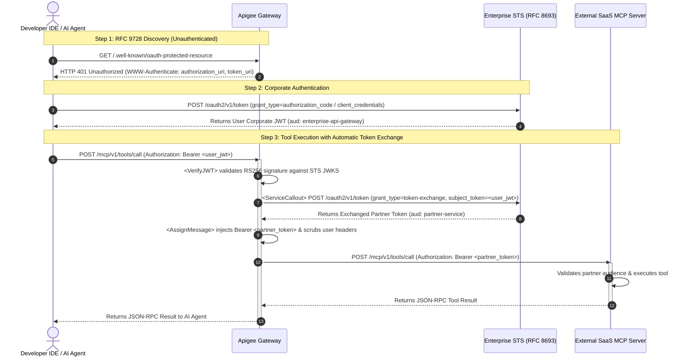

# Enterprise Apigee MCP Gateway — Token Exchange & Discovery

[](https://github.com/krisrowe/apigee-mcp-token-exchange/actions)
[](LICENSE)

A vendor-neutral reference architecture and runnable test harness implementing the **External SaaS MCP Server Authorization Pattern** using **Apigee API Management**, **IETF RFC 8693 (OAuth 2.0 Token Exchange)**, and **IETF RFC 9728 (OAuth 2.0 Protected Resource Metadata)**.

---

## The Enterprise Challenge

When developers connect IDE AI coding assistants (VS Code, Cursor, Windsurf) to external Model Context Protocol (MCP) servers hosted by SaaS partners, enterprises encounter two critical security blockers:

1. **Credential Sprawl:** Forcing developers to manually configure long-lived SaaS API keys or partner tokens on their local laptops creates secret leakage risks.
2. **Identity Exposure:** Passing corporate employee identity tokens directly to third-party SaaS vendors leaks internal enterprise identities and group memberships.

---

## Architectural Solution



1. **RFC 9728 Protected Resource Metadata Discovery:**
   - Unauthenticated agents querying `GET /.well-known/oauth-protected-resource` receive an `HTTP 401 Unauthorized` challenge containing `WWW-Authenticate` metadata headers pointing to the enterprise Authorization Server.
2. **Inbound Identity Verification:**
   - Apigee validates incoming corporate user tokens via the `<VerifyJWT>` policy.
3. **Mid-Flight Token Exchange (RFC 8693):**
   - Apigee executes a `<ServiceCallout>` to the enterprise Security Token Service (STS) with `grant_type=urn:ietf:params:oauth:grant-type:token-exchange`.
   - The STS mints a down-scoped, short-lived token targeted specifically for the downstream SaaS partner (`aud: https://mcp.partner-service.example.com`).
4. **Header Sanitization & Egress:**
   - Apigee injects `Authorization: Bearer <exchanged_partner_token>` and strips internal corporate headers (`x-internal-user-id`, `x-internal-employee-email`) before proxying to the partner MCP backend.

---

## Repository Structure

```text
.
├── Makefile                # setup, test, bundle, clean
├── pyproject.toml          # Test dependencies (FastAPI, FastMCP, Pytest)
├── architecture_flow.mmd   # Source Mermaid sequence diagram
│
├── apiproxy/               # Production Apigee API Proxy Bundle
│   ├── apiproxy.xml
│   ├── proxies/default.xml # Flow routing & RFC 9728 discovery challenge
│   ├── policies/           # VerifyJWT, ServiceCallout, ExtractVariables, AssignMessage
│   └── targets/default.xml # Outbound partner routing
│
├── mock_idp/               # RFC 8693 Security Token Service (STS) Mock
│   └── app.py
├── mcp_server/             # External SaaS MCP Server Mock
│   └── server.py
├── mock_gateway/           # Local Gateway Runner (emulates Apigee policies)
│   └── app.py
│
└── tests/
    └── test_e2e.py         # Automated sociable end-to-end integration test suite
```

---

## Quickstart

### Prerequisites
- Python 3.11+
- `make`

### 1. Setup Local Environment
```bash
make setup
```

### 2. Run the End-to-End Test Suite
```bash
make test
```

### 3. Build Apigee Proxy Bundle
```bash
make bundle
```
The deployable zip bundle is generated at `dist/apigee-mcp-token-exchange.zip` ready for import into Apigee X or Apigee Hybrid.

---

## Contributing & License

Contributions are welcome. Please ensure all tests pass (`make test`) and pre-commit checks are clean.

Licensed under the [MIT License](LICENSE).
