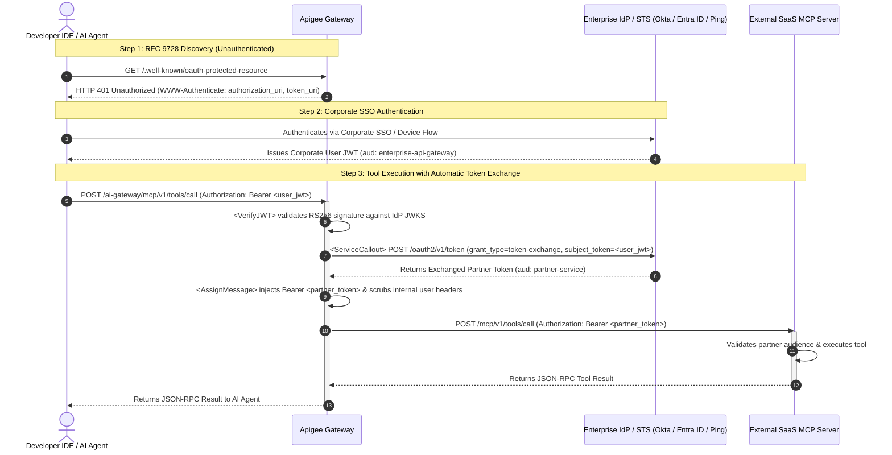

# Enterprise Apigee MCP Gateway — Token Exchange & Discovery

[](LICENSE)

A production-grade, vendor-neutral reference architecture and runnable test harness demonstrating how an enterprise **Apigee API Gateway** mediates access between internal developer AI coding assistants (VS Code, Cursor, Windsurf, Claude Code) and external third-party SaaS Model Context Protocol (MCP) servers.

This architecture leverages two open standards:
- **[IETF RFC 8693](https://datatracker.ietf.org/doc/html/rfc8693):** OAuth 2.0 Token Exchange
- **[IETF RFC 9728](https://datatracker.ietf.org/doc/html/rfc9728):** OAuth 2.0 Protected Resource Metadata Discovery

---

## The Enterprise Challenge

Connecting developer IDE AI agents to external third-party SaaS MCP servers introduces two major enterprise security dilemmas:

```
❌ The Dangerous Anti-Patterns:
1. Long-Lived Static API Keys on Laptops:
   Developer IDE ──[Static SaaS API Key]──> External SaaS MCP Server (Risk: Secret leakage, no RBAC, no revocation)

2. Leaking Corporate Identity Direct to 3P SaaS:
   Developer IDE ──[Corporate Okta/Entra ID JWT]──> External SaaS MCP Server (Risk: Leaks employee emails, roles & internal claims)
```

### The Architectural Solution: Brokered Token Exchange
The enterprise gateway solves this by acting as an **OAuth 2.0 Token Exchange Broker**:
1. The developer's IDE authenticates exclusively with the internal corporate Identity Provider (IdP) via SSO.
2. The IDE sends requests to the **Apigee Gateway** using the short-lived corporate user JWT.
3. Apigee intercepts the request, calls the enterprise IdP's Security Token Service (STS) to perform an **RFC 8693 Token Exchange**, and trades the corporate identity for a down-scoped partner token.
4. Apigee strips all internal employee claims (`sub`, `email`, employee IDs) and injects the partner token before forwarding the call to the SaaS vendor.

---

## Architectural Sequence Flow



---

## Token Transformation Visual: The Privacy & Security Boundary

The core value proposition of this pattern is ensuring **zero PII leakage** and **strictly scoped partner access**:

| Token Property | Ingress Corporate User JWT (IDE $\rightarrow$ Apigee) | Egress Exchanged Token (Apigee $\rightarrow$ SaaS MCP) |
| :--- | :--- | :--- |
| **Audience (`aud`)** | `https://api-gateway.example.com` (Internal Gateway) | `https://mcp.partner-service.example.com` (Target SaaS) |
| **Subject (`sub`)** | Internal Employee ID / Username | Down-scoped Pseudonymous Subject or Service ID |
| **Employee Claims** | `email`, `department`, `groups`, `roles` | **Completely Omitted / Stripped** |
| **Actor Claim (`act`)** | N/A | `{"sub": "apigee-gateway-client"}` |
| **Scope (`scope`)** | `openid`, `profile`, `internal-tools` | `tools:read`, `tools:execute` (Targeted Scopes) |
| **Lifetime (`exp`)** | Standard corporate session (e.g. 1 hour) | Down-scoped, short-lived (e.g. 15 minutes) |

```json
// Ingress Corporate JWT (Held on Laptop)
{
  "iss": "https://identity.example.com/oauth2/v1",
  "sub": "emp_94821",
  "email": "developer@example.com",
  "roles": ["engineering", "internal-developer"],
  "aud": "https://api-gateway.example.com"
}

// ──[ Apigee RFC 8693 Token Exchange ]──>

// Egress Exchanged Partner Token (Delivered to SaaS Vendor)
{
  "iss": "https://identity.example.com/oauth2/v1",
  "sub": "anon-dev-agent-3948",
  "aud": "https://mcp.partner-service.example.com",
  "scope": "tools:read tools:execute",
  "act": {
    "sub": "apigee-mcp-gateway"
  }
}
```

---

## Developer IDE / Client Configuration

AI coding tools (VS Code Claude Extension, Cursor, Windsurf, Claude Code) connect directly to the **Apigee Gateway Ingress Endpoint**. The developer never handles SaaS API keys or vendor credentials:

```json
{
  "mcpServers": {
    "enterprise-partner-mcp": {
      "type": "sse",
      "url": "https://api-gateway.example.com/ai-gateway/mcp/v1/sse"
    }
  }
}
```

When the client connects:
1. The IDE receives an **RFC 9728 Discovery Challenge** (`HTTP 401 Unauthorized`) with `WWW-Authenticate: authorization_uri="...", token_uri="..."`.
2. The IDE triggers an internal corporate browser/device SSO flow and stores the short-lived corporate JWT.
3. Every subsequent tool call passes through Apigee, where tokens are exchanged seamlessly in-flight.

---

## How to Configure for Your Enterprise IdP (e.g., Okta, Entra ID, Ping)

This reference architecture is designed to map directly to any OAuth 2.0 authorization server that supports RFC 8693 token exchange.

### 1. Identity Provider (IdP) Setup (Okta / Entra ID)
In your corporate IdP console:
1. **Register Apigee Gateway as an OAuth Client:**
   - Client Type: Confidential Client (`client_id` + `client_secret` or mTLS private key JWT).
   - Allowed Grant Types: Enable `Token Exchange` (`urn:ietf:params:oauth:grant-type:token-exchange`).
2. **Configure an Access Policy Rule for Token Exchange:**
   - **Incoming Subject Token:** Must be issued by your corporate IdP with audience set to your Apigee gateway (`aud: enterprise-api-gateway`).
   - **Allowed Actions:** Allow Apigee's `client_id` to exchange the subject token for the target partner audience (e.g. `aud: https://mcp.partner-service.example.com`).
   - **Down-scoped Scopes:** Limit token scopes to `tools:read` and `tools:execute`.
   - **Actor Claims:** Ensure the IdP issues the exchanged token with an actor claim designating Apigee (`act: { sub: "apigee-gateway-client-id" }`).

### 2. Apigee Policy Configuration
The included [`apiproxy/`](apiproxy/) bundle uses standard Apigee policies. To map it to your environment:

1. **Verify Corporate User JWT (`policies/VA-VerifyUserJWT.xml`):**
   - Update `<JWKS uri="https://auth.example.com/oauth2/v1/keys"/>` to your IdP's JWKS endpoint (e.g., `https://your-org.okta.com/oauth2/default/v1/keys`).
   - Set `<Issuer>` to your IdP's issuer URL.
2. **Execute Token Exchange Callout (`policies/SC-RFC8693-TokenExchange.xml`):**
   - Store your Apigee client credentials in an **Apigee Key-Value Map (KVM)** (`private.apigee_client_id`, `private.apigee_client_secret`).
   - Update `<URL>` to your IdP's token endpoint (`https://your-org.okta.com/oauth2/default/v1/token`).
   - Set `<FormParam name="audience">` to the target SaaS partner's audience identifier.
3. **Outbound Partner Target (`targets/default.xml`):**
   - Point `<URL>` to the partner's HTTPS MCP endpoint (e.g. `https://mcp.partner-service.com`).

---

## Repository Structure

```text
.
├── Makefile                # setup, test, studio, bundle, clean
├── pyproject.toml          # Test harness dependencies (FastAPI, FastMCP, Pytest)
├── architecture_flow.mmd   # Source Mermaid sequence diagram
├── studio.html             # Interactive visual X-ray dashboard for live testing
├── run_studio.py           # One-command studio service runner
├── client_bridge.py        # Stdio-to-HTTP MCP bridge for CLI agents & IDEs
│
├── apiproxy/               # Production Apigee API Proxy Bundle
│   ├── apiproxy.xml
│   ├── proxies/default.xml # Ingress routing & RFC 9728 discovery challenge
│   ├── policies/           # VerifyJWT, ServiceCallout (RFC 8693), ExtractVariables, AssignMessage
│   └── targets/default.xml # Outbound partner SaaS target endpoint
│
├── mock_idp/               # Runnable Enterprise IdP / STS Mock (RFC 8693, JWKS & SSO Login)
│   └── app.py
├── mcp_server/             # Runnable External SaaS MCP Server Mock
│   └── server.py
├── mock_gateway/           # Runnable Gateway Runner (simulates Apigee policies locally)
│   └── app.py
│
└── tests/
    └── test_e2e.py         # Automated sociable end-to-end integration test suite
```

---

## Interactive Visual Studio (Live Network Demo)

To experience the architecture visually and inspect real HTTP/OAuth traffic in real time:

```bash
make studio
```

This launches all three local services on loopback ports (`8080`, `8081`, `8082`) and automatically opens `studio.html` in your default browser.

### Workstation & Browser Compatibility
* **Cross-Platform:** Works on macOS, Linux, and Windows with Python 3.11+.
* **Any Modern Browser:** Chrome, Edge, Firefox, or Safari (uses standard ES6 `fetch()`, `window.open()`, and `window.postMessage()`; zero browser extensions required).
* **Live Network Traffic:** Every click makes real HTTP calls across localhost TCP sockets. Open your browser's Developer Tools (`Network` tab) to inspect the headers, status codes, and JSON-RPC payloads live.

### Testing Flexible Environments & Custom Gateways (Query Parameters)
The studio supports dynamic URL query parameters so you can toggle between your local simulation and real cloud environments with zero code modifications:

| Query Parameter | Description | Default Value |
| :--- | :--- | :--- |
| **`?gateway=`** | Ingress Apigee Gateway URL | `http://127.0.0.1:8080` |
| **`?idp=`** | Corporate Identity Provider / STS Base URL | `http://127.0.0.1:8081` |
| **`?backend=`** | Target External SaaS MCP Server Base URL | `http://127.0.0.1:8082` |

**Example Scenarios:**
* **Testing Live Cloud Apigee X:**  
  Load the studio with your Apigee cloud ingress endpoint:  
  `studio.html?gateway=https://api.yourcompany.com/ai-gateway`
* **Testing Real Okta / Entra ID:**  
  Point the studio to your corporate IdP:  
  `studio.html?idp=https://dev-xxxx.okta.com`
* **One-Click Presets & Shareable Links:**  
  Use the **Presets** buttons in the studio header (`Local Mock`, `Cloud Apigee X`) or click **📋 Copy Link** to share the exact test configuration with colleagues.

### Step-by-Step Interactive Journey

1. **Step 1: Discover Protected Resource (`RFC 9728`)**
   - The browser client sends an unauthenticated `GET /.well-known/oauth-protected-resource` to the Apigee Gateway (`:8080`).
   - Apigee responds with **`HTTP 401 Unauthorized`** and attaches the `WWW-Authenticate` header with the authorization and token endpoints.
2. **Step 2: Corporate SSO Sign-In (`OAuth 2.0 PKCE`)**
   - Click "Sign In with SSO". A real browser popup window opens to the **Corporate Identity Provider Sign-In Page** (`:8081/oauth2/v1/authorize`).
   - Pre-filled with demo credentials (`developer@example.com` / `demo123`).
   - Clicking "Authenticate" issues an authorization code, exchanges it for a **Corporate User JWT**, and displays the internal employee claims (`sub`, `aud: enterprise-api-gateway`, `roles`).
3. **Step 3: List Available Tools (`RFC 8693 Token Exchange`)**
   - The client calls `POST /mcp/v1/tools/list` on Apigee with the Corporate User JWT.
   - Watch all four architecture nodes illuminate: Apigee intercepts the user token, calls the Enterprise STS (`:8081`) to perform the RFC 8693 token exchange, scrubs internal employee claims, and returns the available tools (`search_catalog`).
4. **Step 4: Execute Tool Call (`search_catalog`)**
   - The client invokes `search_catalog` through Apigee.
   - Apigee injects the down-scoped partner token (`aud: https://mcp.partner-service.example.com`), and the SaaS backend executes the tool and returns the JSON-RPC response.
5. **Step 5: Security Boundary Enforcement (Negative Test)**
   - Attempts to send the Corporate User JWT directly to the external partner backend (`:8082`), bypassing Apigee.
   - The SaaS backend **rejects it with `HTTP 403 Forbidden`** (*"Direct corporate user tokens rejected"*), proving that external partners cannot accept corporate identity tokens.

---

## CLI Agent & IDE Integration (`client_bridge.py`)

You can also connect real coding agents (Antigravity CLI, Claude Code, Cursor, VS Code) directly to the gateway via the included stdio bridge:

### Using with Antigravity CLI / Claude Code
```bash
# Start background services
python run_studio.py &

# Run agent prompt through the Apigee Gateway
antigravity -p "What tools are available from partner-gateway?"
```
The bridge automatically checks for a cached corporate token, opens the browser SSO login if needed, and translates stdio JSON-RPC to Apigee Gateway HTTP calls.

---

## Quickstart (Run & Test Locally in 60 Seconds)

### Prerequisites
- Python 3.11+
- `make`

### 1. Setup Local Environment
```bash
make setup
```

### 2. Run the End-to-End Test Suite
```bash
make test
```
This launches all three local services over loopback ports (`8080`, `8081`, `8082`) and tests:
- RFC 9728 discovery 401 challenge and headers.
- User SSO token acquisition.
- Dynamic token exchange via the gateway.
- Successful MCP tool call execution (`search_catalog`).
- Rejection of direct corporate token presentation.

### 3. Build Deployable Apigee Bundle
```bash
make bundle
```
The deployable zip bundle is generated at `dist/apigee-mcp-token-exchange.zip`. You can import and deploy this bundle directly into **Apigee X** or **Apigee Hybrid** via the Apigee UI or `apigeecli / apim`.

---

## Contributing & License

Contributions, issues, and feature requests are welcome.

Licensed under the [MIT License](LICENSE).
