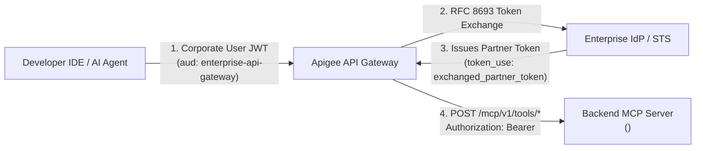

# Backend MCP Server Integration Guide (`mcp_server/server.py`)

> **Part of the [Enterprise Apigee MCP Gateway Reference Architecture](../README.md):**
> In the full end-to-end architecture, an internal developer IDE authenticates with the corporate Identity Provider (IdP) and sends requests to **Apigee**, which performs an **[IETF RFC 8693 OAuth 2.0 Token Exchange](https://datatracker.ietf.org/doc/html/rfc8693)** and forwards a down-scoped partner token to this backend service.
>
> **Using This Document Standalone:**
> If the Backend MCP Server has **already been deployed** and you have been provided its HTTPS URL (`<BACKEND_MCP_URL>`), you can use this document directly as your integration specification to wire up your API Gateway, verify positive/negative security behavior, and execute MCP tools.
> *(Need to deploy your own instance first? See the optional [Cloud Run Deployment Guide](CLOUD-RUN.md) or run locally via the [Main README](../README.md#quickstart-run--test-locally-in-60-seconds).)*

---

## Quick Start: If You Already Have a Deployed `<BACKEND_MCP_URL>`

If someone shared a live Backend MCP URL with you (for example, `https://your-mcp-backend.example.com`), you can immediately verify or integrate with it in three ways:

1. **Run the Automated 8-Test Positive/Negative Suite (`./verify`):**
   Clone this repository and run `./verify --live` from the root directory (it will save the URL in your local XDG cache so future runs only require `./verify --live`):
   ```bash
   git clone https://github.com/krisrowe/apigee-mcp-token-exchange.git
   cd apigee-mcp-token-exchange
   ./verify --live <BACKEND_MCP_URL>
   ```
2. **Wire Your Apigee Proxy Target directly to `<BACKEND_MCP_URL>`:**
   Jump to **[Section 3: Configuring Apigee Proxy Target](#3-configuring-apigee-proxy-target-apiproxytargetsdefaultxml)** for the exact `HTTPTargetConnection` and header requirements.
3. **Test with Standalone `curl` Commands (Zero Repo Clone Required):**
   Jump to **[Section 4B: Manual `curl` Verification](#option-b-manual-curl-verification)** to test the live endpoints directly from any terminal.

---

## 1. Where This Service Fits in the Architecture



The backend MCP server enforces a strict **Zero-PII Partner Boundary**:
- It **never** accepts direct corporate employee tokens (`token_use: "user_identity"`).
- Every MCP tool request must carry an **RFC 8693 Exchanged Partner Token** issued for the target partner audience (`https://mcp.partner-service.example.com`).

---

## 2. Security & Token Verification Contract

### Expected JWT Claims

| Claim | Required Value / Format | Enforcement Behavior |
| :--- | :--- | :--- |
| **`Authorization` Header** | `Bearer <exchanged_partner_jwt>` | Missing or non-Bearer header returns **`HTTP 401 Unauthorized`**. |
| **`aud` (Audience)** | `https://mcp.partner-service.example.com` | Mismatched audience or invalid signature returns **`HTTP 401 Unauthorized`**. |
| **`token_use`** | `exchanged_partner_token` | Any other value (e.g., `user_identity` from an unexchanged corporate SSO token) returns **`HTTP 403 Forbidden`**. |
| **`sub` (Subject)** | Pseudonymous or delegated actor reference (e.g., `actor:user_developer@example.com`) | Recorded in `_meta.delegated_subject` and `actor_context.user_ref`. |
| **`act` (Actor)** | `{"sub": "enterprise-apigee-gateway"}` | Recorded in `_meta.caller_actor` and `actor_context.gateway`. |

> **Reference Signing Key (Demo / Test Harness):**
> By default, the reference implementation validates HS256 signatures using `SECRET_KEY = "enterprise-reference-secret-key-for-jwt"` (defined in [`mcp_server/server.py`](../mcp_server/server.py) and matched by [`mock_idp/app.py`](../mock_idp/app.py)). In production with Okta, Entra ID, or PingFederate, replace this with your IdP's asymmetric RS256 JWKS endpoint.

### HTTP Endpoints & Status Code Matrix

Base URL placeholder: **`<BACKEND_MCP_URL>`** (for example, `https://your-mcp-backend.example.com`)

| Endpoint | Method | Auth Required | Scenario | Expected HTTP Status |
| :--- | :--- | :--- | :--- | :--- |
| `/` or `/health` | `GET` | No | Liveness / readiness probe | **`200 OK`** |
| `/mcp/v1/tools/list` | `POST` | Yes (`Bearer`) | Valid exchanged partner token (`token_use="exchanged_partner_token"`) | **`200 OK`** |
| `/mcp/v1/tools/call` | `POST` | Yes (`Bearer`) | Valid exchanged partner token + `name="search_catalog"` | **`200 OK`** |
| `/mcp/v1/tools/list` | `POST` | Yes (`Bearer`) | Missing `Authorization` header | **`401 Unauthorized`** |
| `/mcp/v1/tools/list` | `POST` | Yes (`Bearer`) | Tampered JWT signature or expired token | **`401 Unauthorized`** |
| `/mcp/v1/tools/list` | `POST` | Yes (`Bearer`) | Wrong `aud` claim (not `https://mcp.partner-service.example.com`) | **`401 Unauthorized`** |
| `/mcp/v1/tools/list` | `POST` | Yes (`Bearer`) | Unexchanged corporate user token (`token_use="user_identity"`) | **`403 Forbidden`** |
| `/mcp/v1/tools/call` | `POST` | Yes (`Bearer`) | Valid exchanged partner token + unknown tool name | **`404 Not Found`** |

---

## 3. Configuring Apigee Proxy Target (`apiproxy/targets/default.xml`)

To connect your Apigee API Proxy to the deployed backend at `<BACKEND_MCP_URL>`:

1. **In your Apigee Token Exchange policy ([`apiproxy/policies/SC-RFC8693-TokenExchange.xml`](../apiproxy/policies/SC-RFC8693-TokenExchange.xml)):**
   Ensure the requested `audience` parameter matches `https://mcp.partner-service.example.com` and the issued token includes `token_use: "exchanged_partner_token"`.
2. **In your Apigee AssignMessage policy ([`apiproxy/policies/AM-SetPartnerAuthHeader.xml`](../apiproxy/policies/AM-SetPartnerAuthHeader.xml)):**
   Set `Authorization: Bearer {exchanged_partner_token}` and strip any internal employee headers.
3. **In your Apigee TargetEndpoint ([`apiproxy/targets/default.xml`](../apiproxy/targets/default.xml)):**
   Point `<URL>` inside `<HTTPTargetConnection>` to `<BACKEND_MCP_URL>`:

```xml
<?xml version="1.0" encoding="UTF-8" standalone="yes"?>
<TargetEndpoint name="default">
    <Description>Outbound Partner SaaS MCP Server</Description>
    <PreFlow name="PreFlow">
        <Request>
            <!-- Injects exchanged partner token & strips corporate employee headers -->
            <Step>
                <Name>AM-SetPartnerAuthHeader</Name>
            </Step>
        </Request>
        <Response/>
    </PreFlow>
    <HTTPTargetConnection>
        <URL>https://your-mcp-backend.example.com</URL>
    </HTTPTargetConnection>
</TargetEndpoint>
```

You can also point the interactive visual protocol console ([`console.html`](../console.html)) directly at your live backend using the `?backend=` query parameter:

```text
console.html?backend=https://your-mcp-backend.example.com
```

---

## 4. Verifying a Live Backend Deployment

### Option A: Automated Positive & Negative Verification CLI (`./verify`)

The repository includes an executable [`./verify`](../verify) CLI script at the project root that runs all 8 positive (`200`) and negative (`401`, `403`, `404`) test cases against your deployed backend URL and caches the URL in `~/.cache/apigee-mcp-token-exchange/context.json` for subsequent runs:

```bash
# First run: pass your Backend MCP URL (or omit it to be prompted interactively)
./verify --live https://your-mcp-backend.example.com

# Subsequent runs: automatically reuses your cached URL
./verify --live
```

*(For CI/CD pipelines, you can also invoke `pytest` directly via `MCP_BACKEND_URL=https://your-mcp-backend.example.com .venv/bin/pytest tests/integration/real-user/ -v -s`.)*

**Expected Output (`8 passed` across positive and negative HTTP assertions):**
```text
==> Target Backend URL : https://your-mcp-backend.example.com
==> Saved to XDG cache : ~/.cache/apigee-mcp-token-exchange/context.json

tests/integration/real-user/test_live_backend.py::test_live_health_check_200
[LIVE GET /] -> HTTP 200 | {'status': 'ok', 'service': 'catalog-mcp-backend', 'runtime': 'cloud-run'}
PASSED
tests/integration/real-user/test_live_backend.py::test_live_negative_missing_auth_header_401
[LIVE POST /mcp/v1/tools/list (No Auth Header)] -> HTTP 401 | {'detail': "Missing or malformed Authorization header. Expected 'Bearer <token>'"}
PASSED
tests/integration/real-user/test_live_backend.py::test_live_negative_tampered_signature_401
[LIVE POST /mcp/v1/tools/list (Tampered Signature)] -> HTTP 401 | {'detail': 'Invalid partner token: Signature verification failed.'}
PASSED
tests/integration/real-user/test_live_backend.py::test_live_negative_wrong_audience_401
[LIVE POST /mcp/v1/tools/list (Wrong Audience)] -> HTTP 401 | {'detail': 'Invalid partner token: Invalid audience'}
PASSED
tests/integration/real-user/test_live_backend.py::test_live_negative_unexchanged_corporate_token_403
[LIVE POST /mcp/v1/tools/list (Unexchanged Corporate Token)] -> HTTP 403 | {'detail': 'Token is not an exchanged partner token. Direct corporate user tokens rejected.'}
PASSED
tests/integration/real-user/test_live_backend.py::test_live_positive_tools_list_200
[LIVE POST /mcp/v1/tools/list (Valid Exchanged Token)] -> HTTP 200 | {'jsonrpc': '2.0', 'id': 'list-1', 'result': {'tools': [{'name': 'search_catalog', ...}], '_meta': {'caller_actor': 'enterprise-apigee-gateway', 'delegated_subject': 'actor:user_developer@example.com'}}}
PASSED
tests/integration/real-user/test_live_backend.py::test_live_positive_tools_call_search_catalog_200
[LIVE POST /mcp/v1/tools/call (search_catalog)] -> HTTP 200 | {'jsonrpc': '2.0', 'id': 'live-call-1', 'result': {'content': [{'type': 'text', 'text': "Found 3 catalog results matching query: 'sparkling water'."}], 'actor_context': {'gateway': 'enterprise-apigee-gateway', 'user_ref': 'actor:user_developer@example.com'}}}
PASSED
tests/integration/real-user/test_live_backend.py::test_live_negative_unknown_tool_404
[LIVE POST /mcp/v1/tools/call (unknown_tool)] -> HTTP 404 | {'detail': "Tool 'unknown_tool' not found"}
PASSED
```

### Option B: Manual `curl` Verification

1. **Health Check (`HTTP 200`):**
   ```bash
   curl -i https://your-mcp-backend.example.com/
   ```

2. **Negative Test: Missing Authorization Header (`HTTP 401`):**
   ```bash
   curl -i -X POST https://your-mcp-backend.example.com/mcp/v1/tools/list \
     -H "Content-Type: application/json" \
     -d '{"jsonrpc": "2.0", "id": "1"}'
   ```

3. **Positive Test: List Tools with Exchanged Partner Token (`HTTP 200`):**
   ```bash
   curl -i -X POST https://your-mcp-backend.example.com/mcp/v1/tools/list \
     -H "Authorization: Bearer <EXCHANGED_PARTNER_JWT>" \
     -H "Content-Type: application/json" \
     -d '{"jsonrpc": "2.0", "id": "list-1"}'
   ```

4. **Positive Test: Execute `search_catalog` Tool Call (`HTTP 200`):**
   ```bash
   curl -i -X POST https://your-mcp-backend.example.com/mcp/v1/tools/call \
     -H "Authorization: Bearer <EXCHANGED_PARTNER_JWT>" \
     -H "Content-Type: application/json" \
     -d '{
       "jsonrpc": "2.0",
       "id": "call-1",
       "params": {
         "name": "search_catalog",
         "arguments": {"query": "organic apples", "limit": 3}
       }
     }'
   ```

---

## Related Guides in This Repository

- **[Main Architecture & Local Test Harness (`README.md`)](../README.md):** End-to-end sequence diagrams, RFC 9728 OAuth discovery, interactive browser console (`make console`), and IDE/CLI agent bridge (`client_bridge.py`).
- **[Optional Cloud Run Deployment Guide (`docs/CLOUD-RUN.md`)](CLOUD-RUN.md):** How to publish [`mcp_server/server.py`](../mcp_server/server.py) to Cloud Run using standard `gcloud run deploy` or `gapp`.
- **[Apigee API Proxy Bundle (`apiproxy/`)](../apiproxy/):** Production XML policies for `<VerifyJWT>`, `<ServiceCallout>` (RFC 8693 Token Exchange), and `<AssignMessage>`.
